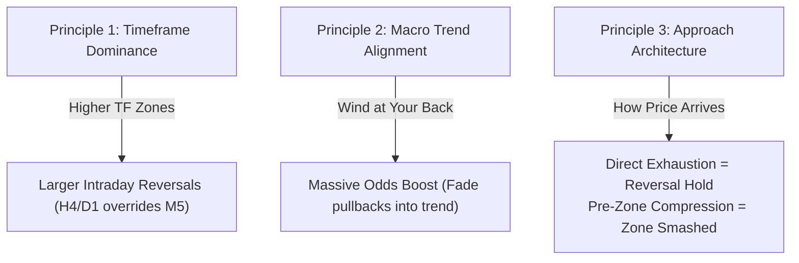

# Yad Masri Webinar Master Documentation: Contextual Market Reading & Fractal Trade Execution

## 1. Executive Summary & Philosophy
This webinar by **Ziad (Yad) Masri** presents a trading philosophy centered on the premise that 95% of retail traders lose because they trade technical patterns (candlesticks, indicators, breakouts) in an **isolated vacuum**, without understanding the underlying institutional mechanics of the market.

To build a sustainable trading edge, a trader must master two interconnected pillars:
1. **Contextual Market Reading**: Reading beneath the surface of price charts to gauge the environment, market participant positioning, and institutional inventory traps.
2. **Fractal Trade Execution**: Executing against the retail crowd at key multi-timeframe boundaries without waiting for lagging "confirmation" that ruins risk-to-reward ratios.

---

## 2. Core Concepts & Terminology

### A. Contextual Market Reading vs. Vacuum Analysis
* **Vacuum Analysis (Retail Trap):** Treating a bullish engulfing bar, RSI oversold condition, or a double bottom as an isolated trigger anywhere on a chart.
* **Contextual Reading (Institutional Reality):** Asking:
  * *Who is currently trapped?*
  * *Where did true directional conviction begin?*
  * *Is the market balancing (in equilibrium) or trending?*
  * *Is price approaching a higher-timeframe wall of demand/supply?*

### B. The Mechanics of Market Balance (Equilibrium)
* Markets spend roughly 70–80% of their time in **balance** (consolidation/sideways trading).
* During a balancing phase, high volume is transacted as buyers and sellers battle.
* When price aggressively breaks out of a balance area with large range/volume bars (directional conviction), one group is immediately trapped offside (e.g. stuck shorts on an upside breakout).
* When price re-visits that origin area later, two forces create an impenetrable "wall":
  1. **Trapped participants** placing orders to scratch/break even on their losing positions.
  2. **Institutions who missed the original move** aggressively bidding to accumulate inventory at wholesale prices.

---

## 3. The Two Core Techniques

### Technique 1: The Automatic Fade Trade
* **Retail Methodology:** Wait for price to touch support, wait for a big green reversal candle, and buy after the candle closes.
  * *Result:* The entry occurs at the top of the bounce, the stop loss must be placed far below the zone (huge risk), and market chop immediately wicks the trader out before the real expansion occurs.
* **Automatic Fade:**
  * Identify a high-conviction institutional zone ahead of time.
  * Place a resting limit order at the boundary of the zone.
  * Place a tight structural stop loss just beyond the zone.
* **Why the Fade Wins Mathematically:**
  1. **Avoids the Chop:** You are filled at the extreme edge rather than chasing the secondary fakeout.
  2. **Immediate Price Edge:** Price rarely slices through institutional walls without initial hesitation/absorption (85%+ reaction rate).
  3. **Halved Risk & Asymmetric R:R:** Buying at the bottom of the zone cuts stop-loss size in half, doubling or tripling the Reward-to-Risk ratio (e.g., 6:1 vs. 2:1).
  4. **Exit Accuracy:** Closer profit targets from an advantageous entry achieve a mathematically higher hit rate.

### Technique 2: Hidden Zones of Supply and Demand
To identify true institutional zones rather than arbitrary retail support/resistance:
1. **Origin of Directional Conviction:** Locate the exact candle or price level where a violent impulse or gap broke out of an extended sideways balance.
2. **Inventory Imbalance:** The wider the consolidation prior to the breakout, the greater the trapped institutional inventory.
3. **Confluence of Structural Factors:**
   * High-volume consolidation nodes.
   * Unfilled liquidity gaps.
   * Multi-touch swing boundaries on higher timeframes.

---

## 4. The Three Fundamental Market Principles

### Principle 1: The Larger the Timeframe of the Zone, the Larger the Intraday Reversal
* A support/resistance zone created by a multi-day or multi-week balance area carries overwhelming liquidity.
* An intraday M5 or M15 sell-off into an H4 or Daily institutional zone will almost always hit an immediate wall of absorption. Intraday momentum is dwarfed by macro inventory.

### Principle 2: Alignment of Higher-Timeframe Bias Multiplies Probability
* Even modest, secondary support zones hold with high probability if they align with the dominant higher-timeframe trend.
* When trading in the direction of the dominant institutional flow, minor pullbacks represent institutional re-accumulation rather than true reversals.

### Principle 3: How Price Approaches the Zone Dictates its Survival
This is one of the most critical, often overlooked insights in technical trading:
* **Scenario A (Direct Exhaustion / High Probability Hold):**
  * Price drops rapidly and directly into a zone from a distance without pausing.
  * Sellers exhaust their short-term fuel into resting institutional bids $\rightarrow$ **V-bottom / violent bounce**.
* **Scenario B (Pre-Zone Compression / High Probability Failure):**
  * Before reaching the zone, price pauses and begins balancing/compressing sideways for several hours just above the zone.
  * *What happens:* Buyers accumulate prematurely, building a massive shelf of stops right inside the zone. When price finally breaks down from this balance, the accumulated momentum slices through the zone like butter. **Do not fade this setup.**

---

## 5. Structural Curriculum for Professional Trading
Yad emphasizes that trading mastery must be learned in a strict hierarchy:
1. **Market Mechanics & Order Flow Context** (How auction markets function, reading participant intent).
2. **Mathematical Risk Control & Position Sizing** (Fixed fractional risk, zero-ruin models).
3. **High-Level Strategy & Adaptive Daily Plans** (Adapting to daily volatility regimes).
4. **Specific Setups & Exits** (Setups are the *last* step, never the first).
5. **Psychological & State Control** (Execution discipline, counter-intuition acceptance).
